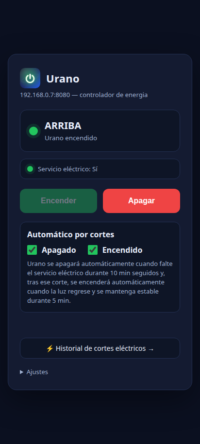
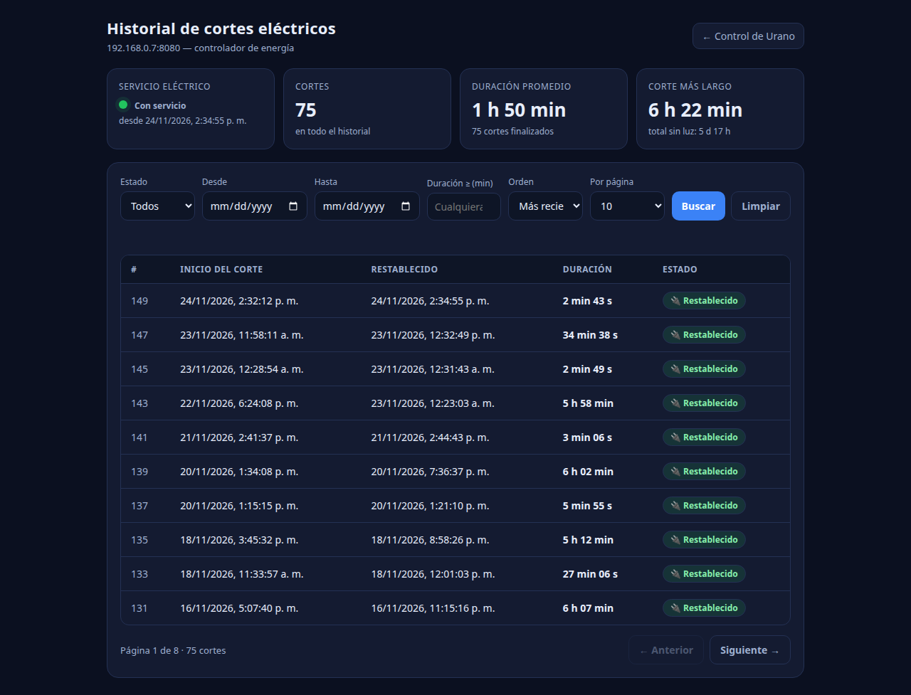

# Urano — Controlador de energía

Sistema de monitoreo y control de energía eléctrica para el hogar, implementado como dos aplicaciones Android que corren en dispositivos de bajo consumo (Fire TV Stick y celular).

## Arquitectura

```
energy-manager/
├── firetv-microservice/   # Servicio principal — corre en un Fire TV Stick
└── urano-remote/          # App de control remoto — corre en un celular
```

### firetv-microservice

Microservicio que se instala en un **Amazon Fire TV Stick** y actúa como el cerebro del sistema:

- **Monitoreo de cortes eléctricos** — Detecta cuando se va o vuelve la luz y registra cada evento en una base de datos local (`PowerHistoryDb`).
- **Historial y estadísticas** — API REST para consultar cortes, resúmenes y duración promedio (`PowerHistoryQuery`, `ResumenCortes`).
- **Servidor HTTP embebido** — Expone una UI web (`TinyHttpServer`) accesible desde cualquier navegador en la red local (`http://<ip-del-stick>:8080/`).
- **Dashboard de cortes** — Página interactiva con filtros por fecha, duración, estado y paginación.
- **Notificaciones por Telegram** — Envía alertas de cortes y restablecimientos con cola y deduplicación (`Notificador`, `ColaAlertas`, `TelegramTransporte`).
- **Política de corte automático** — Lógica configurable para apagar o encender dispositivos cuando se detecta un corte (`PoliticaCorte`, `AutoCorteMonitor`).
- **Apagado remoto por SSH** — Apaga dispositivos en la red mediante SSH (`SshClient`).
- **Wake-on-LAN** — Enciende dispositivos por red (`WolSender`).
- **Ping de red** — Verifica conectividad de dispositivos (`Pinger`).
- **Arranque automático** — Se reinicia al encender el Fire TV (`BootReceiver`) y se mantiene vivo con un watchdog interno.

### urano-remote

Aplicación Android para **celular** que funciona como control remoto:

- **WebView** que carga la UI web del microservicio (`http://<ip-del-stick>:8080/`).
- Permite acceder y controlar Urano desde cualquier lugar de la red (o fuera, si se configura acceso remoto).

## Tecnologías

| Componente | Tecnología |
|---|---|
| Lenguaje | Java 8 |
| Plataforma | Android (minSdk 22, targetSdk 28) |
| Build | Manual con `aapt2` + `d8` + `javac` (sin Gradle ni Maven) |
| Base de datos | SQLite (local en el Fire TV) |
| Servidor HTTP | Implementación propia (`TinyHttpServer`) |
| SSH | JSch (mwiede fork) |
| Notificaciones | Telegram Bot API |

## Requisitos

- **Android SDK** con `build-tools/35.0.0` y `platforms/android-28`
- **Java JDK 8+**
- **ADB** (Android Debug Bridge)
- **Fire TV Stick** (para el microservicio)
- **Celular Android** (para la app remota, opcional)

## Construcción y despliegue

### firetv-microservice

```bash
cd firetv-microservice

# Compilar + instalar + lanzar en el Fire TV
./build.sh

# Solo compilar el APK
./build.sh build

# Ejecutar tests de lógica pura
./build.sh test

# Empujar configuración (urano.json + clave SSH) y reiniciar
./build.sh config
```

### urano-remote

```bash
cd urano-remote

# Configurar el token (una sola vez; local.properties está en .gitignore)
cp local.properties.example local.properties
# editar local.properties y completar URANO_TOKEN

# Compilar + instalar en el celular
./build.sh

# Solo compilar el APK
./build.sh build
```

El token se inyecta en tiempo de compilación como `BuildConfig.TOKEN`; nunca debe escribirse en el código fuente.

## Configuración

El microservicio lee su configuración desde `config/urano.json`, que se despliega al dispositivo con `./build.sh config`. Este archivo contiene:

- Credenciales del bot de Telegram (token, chat ID)
- Dispositivos a monitorear (IP, MAC para WoL)
- Políticas de corte automático
- Configuración SSH para apagado remoto

La clave SSH (`config/id_urano`) se empuja por separado y se usa para apagar dispositivos remotos.

> **Importante:** Estos archivos están en `.gitignore` y no deben comprometerse al repositorio.

## Acceso a la UI

Una vez instalado y en ejecución, accede desde cualquier navegador en la red local:

```
http://<ip-del-fire-tv>:8080/
```

La página principal muestra el estado actual del servicio eléctrico y permite navegar al historial de cortes.

## Capturas

| Panel de control (`/`) | Historial de cortes (`/power_dashboard`) |
|---|---|
|  |  |

## Notas

- El Fire TV Stick debe tener desactivadas las optimizaciones de energía para que el servicio se mantenga en ejecución (el script de build aplica la whitelist automáticamente).
- La app no usa aceleración GPU para evitar retener ~8 MB de contexto GL innecesariamente.
- Los builds son completamente manuales — no se requiere Gradle, Maven ni ningún IDE.
